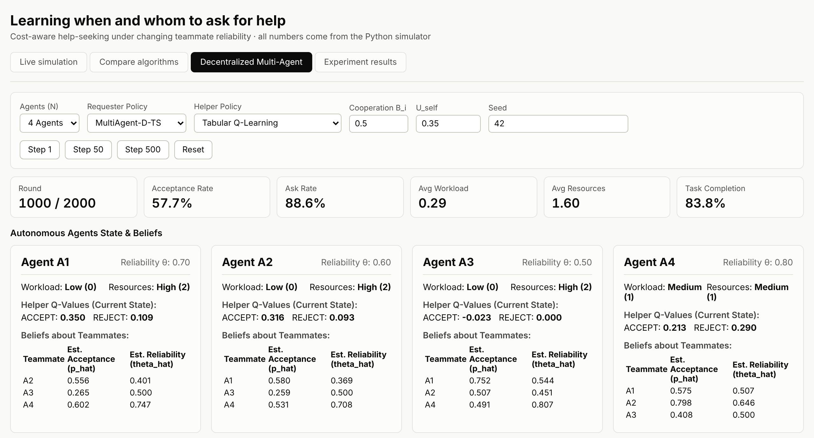
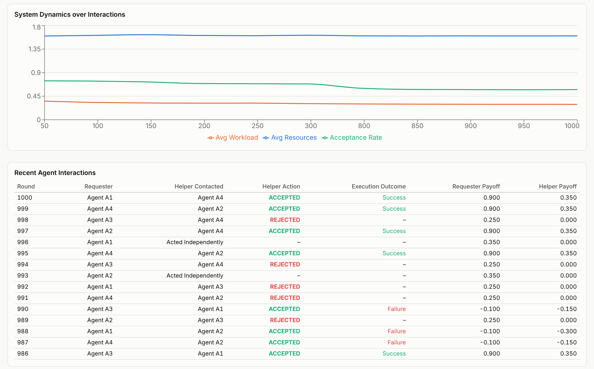
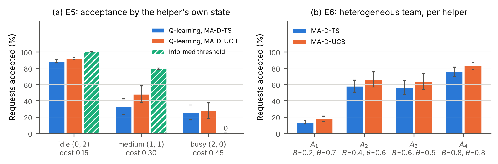
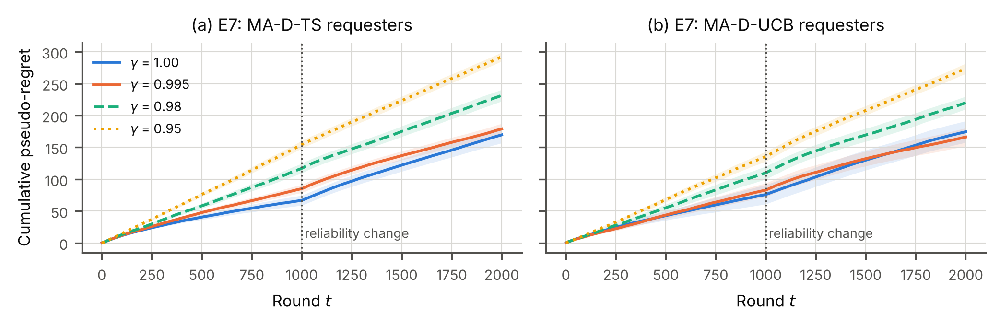
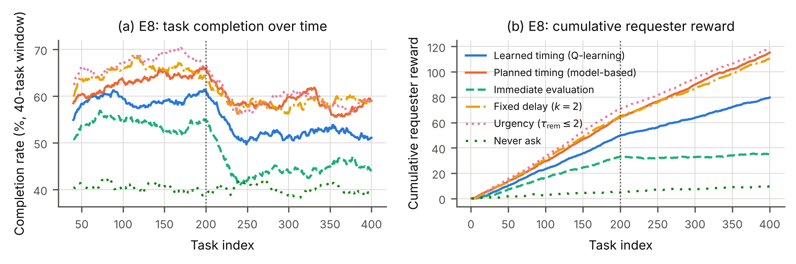

# Learning Whether, When, and Whom to Ask for Help in a Decentralized Multi-Agent Team under Changing Teammate Reliability

Course project · Foundations of AI: Multi-Agent Systems  
Team: Cherukuri Harshith Sai, Atragada Venkata Naga Sai Ganesh, Ambati Chaitanya Ram, Dasari Lohith

## Overview

A team of $N=4$ agents, each of which can be a **requester** (it received a task) or a **helper** (a teammate asked it for help). Every agent learns, from its own individual reward, four decisions:

1. **When to ask** — under a deadline, either a 27-state tabular Q-learning timing policy (`RequesterTimingPolicy`) or a model-based planner that solves the optimal-stopping problem with the learned beliefs (`PlannedTimingPolicy`) decides whether to keep working alone or to evaluate help (E8).
2. **Whether to ask** — compare working alone ($U^{\text{self}}$, or the exact value of finishing alone in E8) with the expected value of asking.
3. **Whom to ask** — discounted Beta–Bernoulli beliefs about each teammate's *acceptance probability* and *execution reliability*, used by MA-Greedy, MA-D-UCB or MA-D-TS.
4. **Whether to help** — each helper runs its own decision-epoch Q-learning over its private state (workload $w$, resources $\rho$). Helping costs more when the helper is busy: reward $B_j x - \kappa_j(w,\rho)$ with $\kappa_j(w,\rho) = c_{\text{res}}(3-\rho) + c_{\text{opp}}(1+w)$ (0.15 idle, 0.45 busy). A helper's state therefore depends on how often the *other* agents ask it.

The environment only assigns tasks (round-robin) and draws outcomes; there is no central controller and no shared reward. A rejection is not an execution failure: the requester falls back to working alone.

---

## Headline Results (30 seeds, mean ± 95% CI)

| Experiment | Question | Key finding |
|---|---|---|
| **E1** | Whom (stationary) | At reliability gap 0.10, D-TS regret $23.2 \pm 3.8$ (best teammate in 91% of rounds) vs D-UCB $67.3 \pm 3.1$ and random $201.0 \pm 1.4$. |
| **E2** | Whether | As $U^{\text{self}}$ rises from 0.30 to 0.80, the D-TS ask rate falls from 100% to 18.9%. |
| **E3** | Abrupt change | $\gamma=0.98$ cuts D-TS median adaptation time from 414 to 64 rounds and post-change regret from 170.0 to 57.9 (pre-change regret rises from 9.7 to 39.2). |
| **E4** | Communication cost | As $\lambda$ grows, D-TS moves from the reliable but expensive teammate to cheaper ones and finally to working alone. |
| **E5** | Helper learning | Q-learning helpers accept $88.5 \pm 2.0\%$ of requests when idle, $32.7 \pm 9.6\%$ at medium load and $25.7 \pm 9.2\%$ when busy (MA-D-TS requesters). An informed threshold rule accepts 100% / 79.3% / 0%. Learned helpers earn less than the informed rule (helper utility 0.105 vs 0.136 per round, $p < 10^{-8}$). |
| **E6** | Incentives | Acceptance rises from $9.5\%$ ($B=0.2$) to $82.1\%$ ($B=0.8$), and welfare from 0.309 to 0.800. In a heterogeneous team, $A_4$ ($B=0.8$, $\theta=0.8$) accepts 75.5% and helps in 35.8% of rounds; $A_1$ ($B=0.2$) accepts 13.6% and helps in 1.3%. |
| **E7** | Changing reliability | Per-round $\gamma=0.98$ *hurts* in the team (MA-D-TS total regret 231.6 vs 169.6 at $\gamma=1$, $p<10^{-8}$), because each requester sees each teammate rarely. $\gamma=0.995$ ($0.995^4\approx0.98$ per own decision) lowers post-change regret (MA-D-UCB 83.3 vs 98.6, $p=0.03$; MA-D-TS 93.9 vs 102.9, $p=0.09$) at the cost of pre-change regret. |
| **E8** | When to ask | Model-free learned timing (Q-learning): $55.1 \pm 2.2\%$ completion, reward $0.199 \pm 0.031$, asks on 62.3% of tasks; it beats Immediate evaluation (48.7%, 0.087) and Never ask (40.3%) but **not** Fixed delay (61.4%, 0.277) or Urgency (62.6%, 0.297). **Planned timing** (approximate optimal stopping with frozen learned beliefs) reaches $60.5 \pm 1.8\%$ and reward $0.288 \pm 0.027$ — not significantly different from the two rules in reward ($p=0.18$, $0.28$) — while asking on only 43.8% of tasks. |
| **S1–S5** | Robustness & sensitivity | Parameter sweeps over memory discounting $\gamma$, UCB exploration $\alpha_{\mathrm{ucb}}$, continuous drift, and multi-shift non-stationarity confirm policy stability across environmental regimes. |

Full numbers: `results/RESULTS_SUMMARY.md` (master summary: E1–E8, S1–S5), `results/MULTIAGENT_RESULTS_SUMMARY.md` (E5–E8), and the report `report/main.pdf`.

---

## Repository Layout

```text
Decentralized-MultiAgent-HelpSeeking/
│
├── backend/
│   ├── src/
│   │   └── help_seeking/
│   │       ├── __init__.py
│   │       ├── acceptance.py
│   │       ├── algorithms.py
│   │       ├── api.py
│   │       ├── autonomous_agent.py
│   │       ├── baselines.py
│   │       ├── environment.py
│   │       ├── experiments.py
│   │       ├── helper_qlearning.py
│   │       ├── metrics.py
│   │       ├── multiagent_environment.py
│   │       ├── multiagent_policies.py
│   │       ├── multiagent_simulation.py
│   │       ├── policies.py
│   │       ├── reliability.py
│   │       ├── requester_timing.py
│   │       ├── simulation.py
│   │       ├── stats.py
│   │       ├── task_lifecycle.py
│   │       ├── temporal_environment.py
│   │       ├── temporal_simulation.py
│   │       ├── trust.py
│   │       └── utilities.py
│   └── tests/
│
├── configs/
│
├── docs/
│
├── figures/
│
├── frontend/
│   ├── src/
│   │   ├── components/
│   │   │   └── MultiAgentView.tsx
│   │   ├── App.tsx
│   │   ├── App.css
│   │   ├── api.ts
│   │   └── main.tsx
│   ├── dist/
│   │   ├── assets/
│   │   └── index.html
│   ├── index.html
│   ├── package.json
│   ├── package-lock.json
│   ├── tsconfig.json
│   └── vite.config.ts
│
├── report/
│   ├── tables/
│   ├── arxiv.sty
│   ├── main.bbl
│   ├── main.pdf
│   ├── main.tex
│   └── references.bib
│
├── results/
│   ├── manifests/
│   ├── processed/
│   ├── raw/
│   ├── MULTIAGENT_RESULTS_SUMMARY.md
│   └── RESULTS_SUMMARY.md
│
├── scripts/
│   ├── _common.py
│   ├── _paths.py
│   ├── analyze_results.py
│   ├── diagnose_e5_helpers.py
│   ├── diagnose_e8_timing.py
│   ├── generate_figures.py
│   ├── generate_multiagent_figures_and_tables.py
│   ├── run_all_experiments.py
│   └── run_experiment.py
│
├── .gitignore
├── PROGRESS.md
├── README.md
├── pytest.ini
└── requirements.txt
```

---

## Quickstart

### 1. Requirements & Testing
Python 3.10+ is required.
```bash
python -m pip install -r requirements.txt
python -m pytest               # 198 tests
```

### 2. Run Experiments & Generate Figures
To run the full suite across all single-agent and multi-agent experiments (E1–E8 and S1–S5 with 30 seeds):
```bash
# Run all experiments
python scripts/run_all_experiments.py

# Analyze experimental results
python scripts/analyze_results.py

# Generate E1-E4 and supplementary figures
python scripts/generate_figures.py

# Generate E5-E8 figures and LaTeX tables
python scripts/generate_multiagent_figures_and_tables.py
```
For a quick smoke test across multi-agent configs:
```bash
python scripts/run_all_experiments.py --only e5 e6 --seeds 3 --T 200 --out results_smoke
```

### 3. Launch Interactive Dashboard
**One server (uses the included production build `frontend/dist`):**
```bash
uvicorn help_seeking.api:app --app-dir backend/src --port 8000
# open http://localhost:8000/
```
(Open the dashboard over HTTP like this; opening `frontend/dist/index.html` directly from the file system does not load its assets.)

**Development mode (hot reload):**
```bash
# Terminal 1: Backend API
uvicorn help_seeking.api:app --app-dir backend/src --port 8000

# Terminal 2: React Dashboard
cd frontend
npm install
npm run dev                    # http://localhost:5173
```

Dashboard features:
- **Multi-Agent Simulation Tab**: Live inspection of $N$ peer agents, per-agent workload & resource gauges, current Q-values table, live belief tracking ($\hat{p}_{ij}$ and $\hat{\theta}_{ij}$), real-time reward & regret trajectories, and round-by-round interaction logs.
- **Single-Agent Benchmark Tabs**: Interactive stepping through E1–E4, multi-algorithm side-by-side comparison, and 30-seed aggregate results viewer.

---

## Interactive Multi-Agent Dashboard Screenshots

### 1. Four Autonomous Agents: Status, Internal States, and Beliefs

*Figure 1: Live inspection of the 4 autonomous peer agents showing physical workload and resource levels, Q-learning values (`Q(Accept)` vs `Q(Reject)`), and decentralized Beta-Bernoulli beliefs (`p̂_ij` acceptance and `θ̂_ij` reliability).*

### 2. Round-by-Round Interaction Logs & Payoffs

*Figure 2: Real-time telemetry displaying sequential task arrivals, requester decision, selected helper, acceptance/rejection response, task realization, and individualized rewards.*

---

## Empirical Results & Visualizations

### E5 / E6: Helping behaviour

*Figure 3: (a) E5 — share of requests accepted in the idle, medium and busy helper states, for Q-learning helpers and the informed threshold. (b) E6 — acceptance per agent in the heterogeneous team.*

### E7: Changing teammate reliability

*Figure 4: Cumulative pseudo-regret for γ ∈ {1, 0.995, 0.98, 0.95} with an abrupt reliability change at t = 1000.*

### E8: When to ask under deadlines (D = 5)

*Figure 5: Completion rate (40-task window) and cumulative requester reward for the six timing policies; reliability change at task 200.*

---

## Result Verification

Every number in the report is generated from the per-seed raw results by the scripts below; the experiments are deterministic given the seed, so re-running them reproduces `results/raw/` exactly.

| Report item | Raw results | Generated by |
|---|---|---|
| Table 1, Figure 1(a) (E5) | `results/raw/E5_helper_learning/runs.csv` | `scripts/generate_multiagent_figures_and_tables.py` |
| Table 2, Figure 1(b) (E6) | `results/raw/E6_multiagent_cooperation/runs.csv` | same |
| Table 3, Figure 2 (E7) | `results/raw/E7_changing_reliability/runs.csv`, `curves.npz` | same |
| Table 4, Figure 3 (E8) | `results/raw/E8_temporal_help_seeking/runs.csv`, `curves.npz` | same |
| p-values and all E5–E8 numbers in the text | `results/processed/multiagent_key_numbers.json`, `results/MULTIAGENT_RESULTS_SUMMARY.md` | same |
| E1–E4, S1–S5 numbers | `results/processed/key_numbers.json`, `results/RESULTS_SUMMARY.md` | `scripts/analyze_results.py` |
| E8 timing diagnostic (longer training, greedy evaluation) | `results/processed/e8_timing_diagnostics.txt` | `scripts/diagnose_e8_timing.py` (~4 min) |
| E5 helper diagnostic (count-based learning rate, longer training) | `results/processed/e5_helper_diagnostics.txt` | `scripts/diagnose_e5_helpers.py` (~6 min) |

```bash
python scripts/run_experiment.py configs/e5_helper_learning.json configs/e6_multiagent_cooperation.json \
    configs/e7_changing_reliability.json configs/e8_temporal_help_seeking.json   # ~4 min on 2 cores
python scripts/generate_multiagent_figures_and_tables.py
cd report && pdflatex main && bibtex main && pdflatex main && pdflatex main
```

---

## Group Contributions & Task Fulfillment Status

In accordance with course submission guidelines, the division of responsibilities and task fulfillment status across all group members are detailed below:

- **Cherukuri Harshith Sai (Roll No: 24110091):** Formulated the decentralized multi-agent system architecture, derived the temporal help-seeking lifecycle and 27-state `RequesterTimingPolicy` Q-learning model, developed the exact dynamic oracle with tie-breaking sets $\mathcal{O}_t$, authored core mathematical specifications, and led the final paper drafting and revision.  
  *(Assigned tasks: Architecture, Timing Formulation, Oracle Derivations, Paper Writing --- **Status: Fulfilled**)*

- **Atragada Venkata Naga Sai Ganesh (Roll No: 24110060):** Implemented the decentralized interaction environment (`MultiAgentEnvironment` and `TemporalMultiAgentEnvironment`), designed agent internal state transitions for all four activities (`execute_own_task`, `help_another_agent`, `rest`, `reject_request`), implemented state-visitation tracking, and engineered the 198-test verification suite.  
  *(Assigned tasks: Environment Protocol, Activity Dynamics, State Tracking, Verification Suite --- **Status: Fulfilled**)*

- **Ambati Chaitanya Ram (Roll No: 24110035):** Developed the decision-epoch semi-Markov helper Q-learning module (`HelperQLearning`) with geometric discounting, implemented decoupled Beta--Bernoulli belief tracking for peer acceptance and execution reliability, executed experimental sweeps E5, E6, and E7 over 30 random seeds ($T=2000$), and validated data aggregation.  
  *(Assigned tasks: Helper Q-Learning, Belief Tracking, Experiments E5--E7, Result Processing --- **Status: Fulfilled**)*

- **Dasari Lohith (Roll No: 24110100):** Designed and benchmarked baseline timing heuristics (Immediate, Fixed Delay, Urgency, Never-Ask), conducted Experiment E8 over 30 seeds ($T=400$), implemented automated LaTeX table and publication figure generation pipelines, and integrated multi-agent live telemetry into the interactive frontend and FastAPI dashboard.  
  *(Assigned tasks: Timing Baselines, Experiment E8, Figure/Table Pipelines, Dashboard Telemetry --- **Status: Fulfilled**)*

---

## Repository & Final Submission Link

- **GitHub Repository**: [https://github.com/HarshithSai91/Decentralized-MultiAgent-HelpSeeking](https://github.com/HarshithSai91/Decentralized-MultiAgent-HelpSeeking)
- **Report**: [report/main.pdf](report/main.pdf) (arXiv format, 8 pages)
